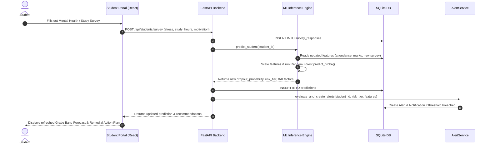
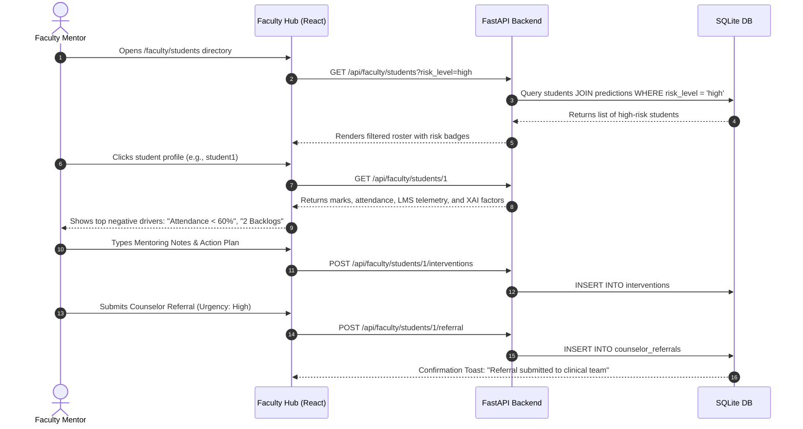

# 📘 Comprehensive System Codebook, Data Dictionary & Technical Specification
## Student Academic Performance & Dropout Risk Predictor
**MIT School of Computing — Department of Computer Science & Engineering**

---

## 📑 Table of Contents
1. [Executive Summary & Purpose](#1-executive-summary--purpose)
2. [High-Level System Architecture & Technology Stack](#2-high-level-system-architecture--technology-stack)
3. [Project Directory & File Structure](#3-project-directory--file-structure)
4. [Relational Database Schema & Data Dictionary](#4-relational-database-schema--data-dictionary)
5. [Machine Learning Pipeline, Mathematics & Features](#5-machine-learning-pipeline-mathematics--features)
   - 5.1 The 17 Base Predictive Features
   - 5.2 Derived Interaction Features & Mathematical Formulas
   - 5.3 Data Preprocessing & Cleaning Pipeline
   - 5.4 Multi-Model Tournament & Algorithms
   - 5.5 Explainable AI (XAI) & Factor Attribution
   - 5.6 Risk Classification & Grade Band Formulas
6. [Backend Code & Function Reference](#6-backend-code--function-reference)
   - 6.1 Core Application & Dependency Injection (`main.py`, `deps.py`, `config.py`)
   - 6.2 Service Layer (`alert_service.py`, `student_service.py`, `auth_service.py`)
   - 6.3 Machine Learning Module (`preprocessing.py`, `train.py`, `predict.py`, `feature_engineering.py`)
   - 6.4 API Routers & Endpoint Logic
7. [Comprehensive REST API Reference Specification](#7-comprehensive-rest-api-reference-specification)
8. [Frontend Architecture, State & UI Catalog](#8-frontend-architecture-state--ui-catalog)
   - 8.1 State Management & API Interceptors
   - 8.2 Role-Based Routing & Access Control
   - 8.3 Student Portal Views
   - 8.4 Faculty Mentor Portal Views
   - 8.5 Administrator Governance Views
9. [Synthetic Data Generator & Archetype Architecture](#9-synthetic-data-generator--archetype-architecture)
10. [End-to-End Operational Workflows](#10-end-to-end-operational-workflows)
11. [Setup, Deployment & Testing Guide](#11-setup-deployment--testing-guide)
12. [Presentation & Viva Voce Q&A Cheat Sheet](#12-presentation--viva-voce-qa-cheat-sheet)

---

## 1. Executive Summary & Purpose

### 1.1 Problem Statement
Higher education institutions face significant retention challenges. Traditional academic monitoring relies predominantly on end-of-semester exam grades or manual faculty observation, which often identifies student distress too late to prevent course failure or institutional attrition.

### 1.2 The Solution
The **Student Academic Performance & Dropout Risk Predictor** is an enterprise AI decision-support platform that continuously synthesizes:
1. **Longitudinal Academic Trajectories** (Internal marks, exam scores, semester-over-semester trends).
2. **Classroom Attendance Records** (Attendance percentages and 30-day velocity).
3. **Behavioral LMS Telemetry** (Login frequency, learning asset downloads, study duration).
4. **Psychometric Self-Assessments** (Perceived stress, motivation, and study hours).

Using a tournament of 4 validated machine learning algorithms evaluated via 5-Fold Stratified Cross-Validation, the system predicts:
- **Dropout Risk Tier**: High, Medium, or Low risk with calibrated probabilities.
- **Predicted Performance Band**: Final Grade Band (A, B, C, D, F) and passing probability.
- **Actionable Explainability**: Top risk-inducing and risk-mitigating factors per student.
- **Automated Early Warnings**: Proactive alerts dispatched to mentors and students when thresholds are crossed.

---

## 2. High-Level System Architecture & Technology Stack

```
+-------------------------------------------------------------------------------+
|                             CLIENT / USER LAYER                               |
|   +-----------------------+ +-----------------------+ +---------------------+ |
|   |    Student Portal     | |  Faculty Mentor Hub   | |  Admin ML Registry  | |
|   |  - Personal Standing  | |  - Cohort Risk Matrix | |  - Model Tournament | |
|   |  - Grade Forecast     | |  - Student Directory  | |  - Batch CSV Upload | |
|   |  - Survey Submission  | |  - Mentoring Notes    | |  - Institutional BI | |
|   |  - Action Plan / Recs | |  - Counselor Referral | |  - User Provisioning| |
|   +-----------------------+ +-----------------------+ +---------------------+ |
+---------------------------------------+---------------------------------------+
                                        | HTTPS / JSON Web Token (JWT)
                                        v
+-------------------------------------------------------------------------------+
|                       FASTAPI ASGI APPLICATION SERVER                         |
|   +-----------------------------------------------------------------------+   |
|   |  Security & Middleware: CORS Whitelist | OAuth2 Bearer Auth | RBAC    |   |
|   +-----------------------------------------------------------------------+   |
|   |  Routers:                                                             |   |
|   |  /api/auth | /api/students | /api/faculty | /api/admin | /api/alerts  |   |
|   |  /api/predictions | /api/upload | /api/reports                        |   |
|   +-----------------------------------------------------------------------+   |
|   |  Business Services:                                                   |   |
|   |  - AlertService (Threshold check & dispatch)                          |   |
|   |  - StudentService (Dashboard aggregator & recommendations)            |   |
|   |  - AuthService (Bcrypt verification & JWT minting)                    |   |
|   +-----------------------------------------------------------------------+   |
|   |  ML Inference Engine:                                                 |   |
|   |  - Joblib Model Deserializer | StandardScaler Normalizer              |   |
|   |  - Feature Extractor (17 dimensions) | Explainability XAI Engine      |   |
|   +-----------------------------------------------------------------------+   |
+---------------------------------------+---------------------------------------+
                                        | SQLAlchemy 2.0 ORM
                                        v
+-------------------------------------------------------------------------------+
|                       DATA PERSISTENCE & ML ARTIFACTS                         |
|   +-----------------------------------------------------------------------+   |
|   |  SQLite 3 Relational Database (`predictor.db`):                      |   |
|   |  users, students, faculty, academic_records, attendance_records,      |   |
|   |  assignment_records, quiz_records, survey_responses, lms_data,        |   |
|   |  predictions, alerts, interventions, counselor_referrals,             |   |
|   |  notifications, model_versions, data_uploads                          |   |
|   +-----------------------------------------------------------------------+   |
|   |  Serialized Artifacts (`app/ml/models/`):                             |   |
|   |  - `best_model_latest.joblib`  (Serialized Champion Classifier)       |   |
|   |  - `scaler.joblib`             (Fitted StandardScaler weights)        |   |
|   |  - `feature_columns.json`      (Feature ordering schema)              |   |
|   |  - `model_meta.json`           (Hyperparameters, metrics, XAI weights)|   |
|   +-----------------------------------------------------------------------+   |
+-------------------------------------------------------------------------------+
```

### Complete Technology Stack Matrix
| Component | Technology | Version | Purpose |
|---|---|---|---|
| **Backend Framework** | FastAPI | 0.111.0+ | Asynchronous REST API routing, OpenAPI docs |
| **ASGI Web Server** | Uvicorn | 0.30.0+ | Lightning-fast asynchronous server engine |
| **Data Validation** | Pydantic | 2.7.0+ | Strict request/response type modeling & serialization |
| **ORM Layer** | SQLAlchemy | 2.0.0+ | Declarative object-relational mapping |
| **Database** | SQLite 3 | 3.40+ | Local ACID relational persistence (`predictor.db`) |
| **ML Framework** | Scikit-Learn | 1.4.0+ | Model training, cross-validation, scaling |
| **Data Ingestion** | Pandas | 2.2.0+ | CSV ETL, feature matrix assembly, vectorized math |
| **Numeric Matrix Math**| NumPy | 1.26.0+ | Array vectorization, probability sigmoid curves |
| **Model Persistence** | Joblib | 1.4.0+ | Binary serialization of trained models & scalers |
| **Authentication** | Bcrypt & PyJWT | 4.0+ / 3.3+ | Salted password hashing & SHA-256 JWT tokens |
| **Frontend Framework** | React | 19 / 18 | Component-based reactive UI |
| **Frontend Tooling** | Vite | 8.0+ | ESM-native lightning development and build tool |
| **Programming Language**| TypeScript | ~6.0 | End-to-end static typing across UI & API calls |
| **Styling Engine** | Tailwind CSS | 4.0+ | Modern utility CSS framework |
| **Data Visualization** | Recharts | 3.0+ | Dynamic SVG charting (ROC Curves, Gauge, Matrices) |
| **State Management** | Zustand | 5.0+ | Global persistent authentication session store |
| **Icons** | Lucide React | 1.16+ | Clean, high-legibility interface iconography |
| **Automated Testing** | Pytest | 8.2+ | Test suite for API endpoints, ML pipeline, preprocessing |

---

## 3. Project Directory & File Structure

```
predictor/
├── backend/
│   ├── app/
│   │   ├── __init__.py
│   │   ├── config.py             # Pydantic BaseSettings (SECRET_KEY, DB_URL, JWT TTL)
│   │   ├── database.py           # SQLAlchemy engine, SessionLocal, declarative Base
│   │   ├── deps.py               # Dependency injection: DB sessions, JWT verification, RBAC
│   │   ├── main.py               # FastAPI entry point, CORS middleware, router registrations
│   │   ├── ml/
│   │   │   ├── __init__.py
│   │   │   ├── feature_engineering.py # Derived interaction features & formulas
│   │   │   ├── preprocessing.py       # Imputation, IQR clipping, feature matrix builder
│   │   │   ├── train.py               # 4-model tournament, Stratified K-Fold, joblib export
│   │   │   ├── predict.py             # Single/batch inference, XAI attribution, recommendations
│   │   │   └── models/                # Saved model binaries & metadata
│   │   │       ├── best_model_latest.joblib
│   │   │       ├── scaler.joblib
│   │   │       ├── feature_columns.json
│   │   │       └── model_meta.json
│   │   ├── models/                    # SQLAlchemy database tables
│   │   │   ├── __init__.py
│   │   │   ├── user.py                # User credentials & UserRole enum
│   │   │   └── academic.py            # Student, Faculty, Marks, LMS, Predictions, Alerts
│   │   ├── routers/                   # REST API route controllers
│   │   │   ├── __init__.py
│   │   │   ├── auth.py                # Login & /me verification
│   │   │   ├── students.py            # Student portal: dashboard, survey, recommendations
│   │   │   ├── faculty.py             # Faculty portal: cohort metrics, mentoring, referrals
│   │   │   ├── admin.py               # Admin portal: system stats, user provisioning
│   │   │   ├── predictions.py         # Prediction endpoints, batch scoring, retrain trigger
│   │   │   ├── upload.py              # CSV file batch ingestion & validation
│   │   │   ├── reports.py             # Analytical PDF/CSV data exports
│   │   │   └── alerts.py              # Real-time alert polling & read flags
│   │   ├── schemas/                   # Pydantic request & response schemas
│   │   │   ├── __init__.py
│   │   │   ├── auth.py
│   │   │   ├── student.py
│   │   │   └── prediction.py
│   │   └── services/                  # Business logic services
│   │       ├── __init__.py
│   │       ├── alert_service.py       # Automated threshold checks & alert generation
│   │       ├── auth_service.py        # Password hashing & JWT generation
│   │       ├── report_service.py      # Statistical aggregation for reporting
│   │       └── student_service.py     # Aggregated profile & personalized recommendations
│   ├── data/
│   │   ├── seed.py                    # 520+ synthetic student generator & ML bootstrapper
│   │   └── template.csv               # Downloadable batch CSV import template
│   ├── tests/
│   │   ├── test_api.py                # Integration tests for FastAPI endpoints
│   │   ├── test_predict.py            # Unit tests for ML inference & explainability
│   │   └── test_preprocessing.py      # Unit tests for outlier clipping & data imputation
│   ├── Dockerfile                     # Container definition for backend service
│   ├── requirements.txt               # Pinned Python package dependencies
│   └── predictor.db                   # SQLite relational database
├── frontend/
│   ├── src/
│   │   ├── api/
│   │   │   └── client.ts              # Axios instance with Bearer token interceptor
│   │   ├── components/                # Reusable UI widgets
│   │   │   ├── Navbar.tsx             # Responsive global navigation header
│   │   │   └── ProtectedRoute.tsx     # Role-based route guard
│   │   ├── pages/
│   │   │   ├── Login.tsx              # Universal login page with quick-fill demo buttons
│   │   │   ├── About.tsx              # Architecture & institutional mission page
│   │   │   ├── HowItWorks.tsx         # Visual ML tournament & scoring methodology
│   │   │   ├── admin/
│   │   │   │   ├── Dashboard.tsx      # Institutional analytics & department retention heatmaps
│   │   │   │   ├── Models.tsx         # ROC curves, confusion matrix, 1-click retrain
│   │   │   │   ├── Upload.tsx         # Drag-and-drop CSV batch upload with error reporting
│   │   │   │   └── Users.tsx          # Account provisioning & access management
│   │   │   ├── faculty/
│   │   │   │   ├── Dashboard.tsx      # Cohort risk distribution & quick action cards
│   │   │   │   ├── Students.tsx       # Searchable student directory with risk filters
│   │   │   │   └── StudentDetail.tsx  # Student profile, XAI factors, mentoring notes, referral
│   │   │   └── student/
│   │   │       ├── Dashboard.tsx      # GPA, CGPA, risk status, grade band forecast
│   │   │       ├── Survey.tsx         # Mental health, stress, and study habit survey
│   │   │       ├── Recommendations.tsx# Prescriptive study plans & remedial suggestions
│   │   │       └── Alerts.tsx         # Unread warnings & intervention notifications
│   │   ├── store/
│   │   │   └── authStore.ts           # Zustand store with localStorage persistence
│   │   ├── types/
│   │   │   └── index.ts               # Complete TypeScript interface definitions
│   │   ├── App.tsx                    # React Router configuration & route declarations
│   │   ├── main.tsx                   # React root hydration
│   │   └── index.css                  # Tailwind styles and theme definitions
│   ├── package.json                   # Node.js dependencies
│   └── vite.config.ts                 # Vite bundler configuration & dev server proxy
├── docker-compose.yml                 # Multi-container orchestration (FastAPI + React)
├── README.md                          # Quick start instructions
└── SYSTEM_DOCUMENTATION.md            # High-level overview
```

---

## 4. Relational Database Schema & Data Dictionary

The platform operates on a normalized SQLite relational schema defined using SQLAlchemy declarative models in [`academic.py`](file:///c:/Users/aryan/.gemini/antigravity-ide/scratch/predictor/backend/app/models/academic.py) and [`user.py`](file:///c:/Users/aryan/.gemini/antigravity-ide/scratch/predictor/backend/app/models/user.py).

```
                      +-------------------+
                      |       users       |
                      +-------------------+
                      | id (PK)           |
                      | email (UQ)        |
                      | hashed_password   |
                      | role (Enum)       |<-------------+
                      | is_active         |              |
                      +-------------------+              |
                         | 1          | 1                |
                         |            |                  |
                         v 0..1       v 0..1             |
              +-------------+    +-------------+         |
              |  students   |    |   faculty   |         |
              +-------------+    +-------------+         |
              | id (PK)     |    | id (PK)     |         |
              | student_id  |    | faculty_id  |         |
              | full_name   |    | full_name   |         |
              | department  |    | department  |         |
              | semester    |    +-------------+         |
              +-------------+           | 1              |
                 | 1                    |                |
                 |                      |                |
        +--------+--------+-------------+-------+        |
        |        |        |             |       |        |
        v 0..*   v 0..*   v 0..*        v 0..*  v 0..*   |
 +------------+ +------------+ +---------------+ +-------+-----------+
 | academic_  | | attend_    | | interventions | | counselor_        |
 | records    | | records    | | (mentoring)   | | referrals         |
 +------------+ +------------+ +---------------+ +-------------------+
        |        |        |
        v 0..*   v 0..*   v 0..*
 +------------+ +------------+ +---------------+
 | survey_    | | lms_data   | | predictions   |
 | responses  | |            | | (ML results)  |
 +------------+ +------------+ +---------------+
        |                 |
        v 0..*            v 0..*
 +------------+    +---------------+
 | alerts     |    | notifications |
 +------------+    +---------------+
```

### 4.1 Detailed Table Definitions

#### Table 1: `users`
Stores credentials and role-based permissions.
| Column | Type | Constraints | Description |
|---|---|---|---|
| `id` | INTEGER | PRIMARY KEY, AUTOINCREMENT | System user ID |
| `email` | VARCHAR | UNIQUE, NOT NULL, INDEXED | Institutional login email |
| `hashed_password` | VARCHAR | NOT NULL | Salted Bcrypt hash |
| `full_name` | VARCHAR | NOT NULL | Display name of the user |
| `role` | ENUM | NOT NULL | Role: `'student'`, `'faculty'`, `'admin'` |
| `is_active` | BOOLEAN | DEFAULT TRUE | Account state |
| `created_at` | DATETIME | DEFAULT utcnow | Timestamp of creation |

#### Table 2: `students`
Master profile for each enrolled student.
| Column | Type | Constraints | Description |
|---|---|---|---|
| `id` | INTEGER | PRIMARY KEY, AUTOINCREMENT | Internal student row ID |
| `user_id` | INTEGER | FOREIGN KEY -> `users.id`, UNIQUE | Linked auth user account |
| `student_id` | VARCHAR | UNIQUE, NOT NULL, INDEXED | Roll Number (e.g., `MIT2024001`) |
| `full_name` | VARCHAR | NOT NULL | Full student name |
| `email` | VARCHAR | UNIQUE, NOT NULL | Institutional email address |
| `gender` | VARCHAR | NULLABLE | Male / Female / Other |
| `age` | INTEGER | NULLABLE | Age (typically 18–24) |
| `department` | VARCHAR | DEFAULT 'Computer Science & Engineering' | Academic department |
| `semester` | INTEGER | NULLABLE | Current semester (1–8) |
| `year` | INTEGER | NULLABLE | Current academic year (1–4) |
| `address` | VARCHAR | NULLABLE | Residential address |
| `phone` | VARCHAR | NULLABLE | Contact telephone |
| `guardian_name` | VARCHAR | NULLABLE | Emergency contact person |
| `guardian_phone`| VARCHAR | NULLABLE | Emergency phone number |
| `created_at` | DATETIME | DEFAULT utcnow | Registration timestamp |

#### Table 3: `faculty`
Faculty advisors and mentors.
| Column | Type | Constraints | Description |
|---|---|---|---|
| `id` | INTEGER | PRIMARY KEY, AUTOINCREMENT | Internal faculty ID |
| `user_id` | INTEGER | FOREIGN KEY -> `users.id`, UNIQUE | Linked auth user account |
| `faculty_id` | VARCHAR | UNIQUE, INDEXED | Institutional faculty identifier |
| `full_name` | VARCHAR | NOT NULL | Professor / Instructor name |
| `email` | VARCHAR | UNIQUE, INDEXED | Official faculty email |
| `department` | VARCHAR | DEFAULT 'Computer Science & Engineering' | Department affiliation |
| `designation` | VARCHAR | NULLABLE | Title (e.g., Associate Professor) |
| `subjects` | TEXT | NULLABLE | JSON list of assigned courses |
| `created_at` | DATETIME | DEFAULT utcnow | Registration timestamp |

#### Table 4: `academic_records`
Course-by-course examination marks.
| Column | Type | Constraints | Description |
|---|---|---|---|
| `id` | INTEGER | PRIMARY KEY, AUTOINCREMENT | Record ID |
| `student_id` | INTEGER | FOREIGN KEY -> `students.id` | Student reference |
| `subject` | VARCHAR | NOT NULL | Course title (e.g., "Data Structures") |
| `semester` | INTEGER | NOT NULL | Semester when course was taken |
| `year` | INTEGER | NOT NULL | Academic year |
| `internal_marks`| FLOAT | NULLABLE | Continuous assessment score (0–50) |
| `external_marks`| FLOAT | NULLABLE | Final exam score (0–50) |
| `total_marks` | FLOAT | NULLABLE | Aggregate mark (0–100) |
| `max_marks` | FLOAT | DEFAULT 100.0 | Maximum potential mark |
| `grade` | VARCHAR | NULLABLE | Letter grade (A, B, C, D, F) |
| `created_at` | DATETIME | DEFAULT utcnow | Ingestion timestamp |

#### Table 5: `attendance_records`
Course-specific attendance tracking.
| Column | Type | Constraints | Description |
|---|---|---|---|
| `id` | INTEGER | PRIMARY KEY, AUTOINCREMENT | Record ID |
| `student_id` | INTEGER | FOREIGN KEY -> `students.id` | Student reference |
| `subject` | VARCHAR | NOT NULL | Course title |
| `semester` | INTEGER | NOT NULL | Semester of attendance |
| `year` | INTEGER | NOT NULL | Academic year |
| `total_classes` | INTEGER | DEFAULT 0 | Total lectures conducted |
| `attended_classes`| INTEGER | DEFAULT 0 | Lectures student attended |
| `attendance_percentage`| FLOAT | DEFAULT 0.0 | Calculated: `(attended / total) * 100` |

#### Table 6: `assignment_records`
Homework and laboratory submission metrics.
| Column | Type | Constraints | Description |
|---|---|---|---|
| `id` | INTEGER | PRIMARY KEY, AUTOINCREMENT | Record ID |
| `student_id` | INTEGER | FOREIGN KEY -> `students.id` | Student reference |
| `subject` | VARCHAR | NOT NULL | Course name |
| `semester` | INTEGER | NOT NULL | Current semester |
| `total_assignments`| INTEGER | DEFAULT 0 | Assignments assigned |
| `submitted_assignments`| INTEGER | DEFAULT 0 | Assignments turned in |
| `late_submissions`| INTEGER | DEFAULT 0 | Submissions past deadline |
| `avg_score` | FLOAT | DEFAULT 0.0 | Mean score on submitted work |

#### Table 7: `quiz_records`
Continuous assessment quiz telemetry.
| Column | Type | Constraints | Description |
|---|---|---|---|
| `id` | INTEGER | PRIMARY KEY, AUTOINCREMENT | Record ID |
| `student_id` | INTEGER | FOREIGN KEY -> `students.id` | Student reference |
| `subject` | VARCHAR | NOT NULL | Subject name |
| `semester` | INTEGER | NOT NULL | Semester |
| `total_quizzes` | INTEGER | DEFAULT 0 | Quizzes published |
| `attempted_quizzes`| INTEGER | DEFAULT 0 | Quizzes attempted |
| `avg_score` | FLOAT | DEFAULT 0.0 | Mean percentage score on quizzes |

#### Table 8: `survey_responses`
Psychological and lifestyle self-evaluations submitted by students.
| Column | Type | Constraints | Description |
|---|---|---|---|
| `id` | INTEGER | PRIMARY KEY, AUTOINCREMENT | Survey ID |
| `student_id` | INTEGER | FOREIGN KEY -> `students.id` | Student reference |
| `stress_level` | INTEGER | NULLABLE | Self-reported stress (1 = Low, 5 = Severe) |
| `workload_level`| INTEGER | NULLABLE | Perceived academic load (1–5) |
| `study_hours_per_day`| FLOAT | NULLABLE | Independent study hours daily |
| `motivation_level`| INTEGER| NULLABLE | Academic motivation index (1–5) |
| `support_needed`| BOOLEAN | DEFAULT FALSE | Request for faculty or counselor help |
| `support_type` | VARCHAR | NULLABLE | Nature of help (Academic, Emotional, Career) |
| `free_text` | TEXT | NULLABLE | Qualitative student reflections |
| `submitted_at` | DATETIME | DEFAULT utcnow | Submission timestamp |

#### Table 9: `lms_data`
Learning Management System digital telemetry.
| Column | Type | Constraints | Description |
|---|---|---|---|
| `id` | INTEGER | PRIMARY KEY, AUTOINCREMENT | Telemetry ID |
| `student_id` | INTEGER | FOREIGN KEY -> `students.id` | Student reference |
| `semester` | INTEGER | NULLABLE | Semester tracked |
| `login_frequency_per_week`| FLOAT | DEFAULT 0.0 | Average weekly LMS sessions |
| `avg_time_spent_hours`| FLOAT | DEFAULT 0.0 | Weekly hours on LMS courseware |
| `resource_views`| INTEGER | DEFAULT 0 | Downloaded slides/notes count |
| `forum_posts` | INTEGER | DEFAULT 0 | Active discussion contributions |
| `forum_views` | INTEGER | DEFAULT 0 | Passive forum read count |
| `recorded_at` | DATETIME | DEFAULT utcnow | Log timestamp |

#### Table 10: `predictions`
Persisted Machine Learning inferences and explainability metadata.
| Column | Type | Constraints | Description |
|---|---|---|---|
| `id` | INTEGER | PRIMARY KEY, AUTOINCREMENT | Prediction record ID |
| `student_id` | INTEGER | FOREIGN KEY -> `students.id` | Student evaluated |
| `risk_level` | ENUM | NOT NULL | Risk tier: `'low'`, `'medium'`, `'high'` |
| `dropout_probability`| FLOAT | NOT NULL | Calibrated probability of dropout (0.00–1.00) |
| `predicted_grade_band`| VARCHAR| NULLABLE | Forecasted letter grade (A, B, C, D, F) |
| `pass_probability`| FLOAT | NULLABLE | Probability of passing (0.00–1.00) |
| `predicted_score`| FLOAT | NULLABLE | Predicted numeric mark |
| `top_factors` | TEXT | NULLABLE | JSON string of top contributing factors |
| `model_version` | VARCHAR | NULLABLE | Version hash of the model used |
| `created_at` | DATETIME | DEFAULT utcnow | Inference generation timestamp |

#### Table 11: `alerts`
Automated system warnings triggered by risk rules.
| Column | Type | Constraints | Description |
|---|---|---|---|
| `id` | INTEGER | PRIMARY KEY, AUTOINCREMENT | Alert ID |
| `student_id` | INTEGER | FOREIGN KEY -> `students.id` | Flagged student |
| `alert_type` | VARCHAR | NOT NULL | `'risk_level'`, `'low_attendance'`, `'wellness'`, `'risk_change'` |
| `message` | TEXT | NOT NULL | Human-readable explanation |
| `severity` | VARCHAR | DEFAULT 'medium' | Severity level: `'low'`, `'medium'`, `'high'` |
| `is_read` | BOOLEAN | DEFAULT FALSE | Status indicator |
| `created_at` | DATETIME | DEFAULT utcnow | Generation timestamp |

#### Table 12: `interventions`
Faculty mentoring notes and 1-on-1 counseling records.
| Column | Type | Constraints | Description |
|---|---|---|---|
| `id` | INTEGER | PRIMARY KEY, AUTOINCREMENT | Intervention ID |
| `student_id` | INTEGER | FOREIGN KEY -> `students.id` | Mentored student |
| `faculty_id` | INTEGER | FOREIGN KEY -> `faculty.id` | Advising faculty member |
| `message` | TEXT | NOT NULL | Meeting summary and agreed action items |
| `is_acknowledged`| BOOLEAN | DEFAULT FALSE | Has student acknowledged advice |
| `acknowledged_at`| DATETIME| NULLABLE | Timestamp of student sign-off |
| `created_at` | DATETIME | DEFAULT utcnow | Log timestamp |

#### Table 13: `counselor_referrals`
Formal clinical referrals initiated by faculty.
| Column | Type | Constraints | Description |
|---|---|---|---|
| `id` | INTEGER | PRIMARY KEY, AUTOINCREMENT | Referral ID |
| `student_id` | INTEGER | FOREIGN KEY -> `students.id` | Referred student |
| `referred_by_id`| INTEGER | FOREIGN KEY -> `faculty.id` | Initiating professor |
| `reason` | TEXT | NOT NULL | Clinical or behavioral rationale |
| `status` | VARCHAR | DEFAULT 'pending' | Status: `'pending'`, `'in_progress'`, `'resolved'` |
| `notes` | TEXT | NULLABLE | Counselor follow-up notes |
| `created_at` | DATETIME | DEFAULT utcnow | Creation timestamp |
| `updated_at` | DATETIME | DEFAULT utcnow | Status update timestamp |

#### Table 14: `model_versions`
Audit log of all trained ML models and comparative metrics.
| Column | Type | Constraints | Description |
|---|---|---|---|
| `id` | INTEGER | PRIMARY KEY, AUTOINCREMENT | Version entry ID |
| `version` | VARCHAR | NOT NULL | Timestamped version identifier (e.g. `v20261026_214500`) |
| `algorithm` | VARCHAR | NOT NULL | Champion algorithm name (e.g., `RandomForest`) |
| `accuracy` | FLOAT | NULLABLE | Test accuracy score |
| `precision` | FLOAT | NULLABLE | Test precision score |
| `recall` | FLOAT | NULLABLE | Test recall score |
| `f1_score` | FLOAT | NULLABLE | Test F1-score |
| `roc_auc` | FLOAT | NULLABLE | Champion ROC-AUC score |
| `training_samples`| INTEGER | NULLABLE | Number of instances in training fold |
| `is_active` | BOOLEAN | DEFAULT FALSE | Flag indicating if this model serves live traffic |
| `metrics_json` | TEXT | NULLABLE | JSON containing full tournament comparison & CM |
| `trained_at` | DATETIME | DEFAULT utcnow | Training timestamp |

#### Table 15: `data_uploads`
Batch CSV ingestion audit records.
| Column | Type | Constraints | Description |
|---|---|---|---|
| `id` | INTEGER | PRIMARY KEY, AUTOINCREMENT | Upload record ID |
| `filename` | VARCHAR | NOT NULL | Name of ingested file |
| `upload_type` | VARCHAR | NOT NULL | Type: `'attendance'`, `'marks'`, `'assignments'`, `'students'` |
| `status` | VARCHAR | DEFAULT 'processing' | Ingestion status: `'processing'`, `'completed'`, `'failed'` |
| `rows_uploaded`| INTEGER | DEFAULT 0 | Count of successfully committed rows |
| `rows_failed` | INTEGER | DEFAULT 0 | Count of rejected rows |
| `error_report` | TEXT | NULLABLE | Detailed breakdown of validation failures |
| `uploaded_by` | INTEGER | FOREIGN KEY -> `users.id` | User initiating upload |
| `uploaded_at` | DATETIME | DEFAULT utcnow | Upload timestamp |

---

## 5. Machine Learning Pipeline, Mathematics & Features

The ML pipeline is architected around early risk detection, multi-model evaluation, and explainability.

```
Raw DB Tables / CSV Data
           |
           v
+---------------------------------------------------------+
| STEP 1: Feature Extraction (build_features_from_db)     |
| Extracts 17 core dimensions per student                 |
+---------------------------------------------------------+
           |
           v
+---------------------------------------------------------+
| STEP 2: Preprocessing Pipeline (preprocess_dataframe)   |
| - De-duplication                                        |
| - Median Imputation for missing values                  |
| - IQR Outlier Clipping (1.5 * IQR)                      |
| - Domain Boundary Enforcement (e.g. Attendance 0-100)   |
+---------------------------------------------------------+
           |
           v
+---------------------------------------------------------+
| STEP 3: Feature Scaling (StandardScaler)                |
| Z = (X - mu) / sigma                                    |
| Serialized to scaler.joblib                             |
+---------------------------------------------------------+
           |
           v
+---------------------------------------------------------+
| STEP 4: Tournament Model Training (5-Fold Stratified CV)|
| 1. Logistic Regression (L2 penalty)                     |
| 2. Support Vector Classifier (RBF Kernel + Platt prob)  |
| 3. Random Forest (100 Estimators)                       |
| 4. Gradient Boosting (100 Estimators)                   |
+---------------------------------------------------------+
           |
           v
+---------------------------------------------------------+
| STEP 5: Champion Selection & Persistence                |
| Highest Cross-Validated ROC-AUC selected                |
| Saved to best_model_latest.joblib & model_meta.json     |
+---------------------------------------------------------+
           |
           v
+---------------------------------------------------------+
| STEP 6: Explainable AI & Scoring Engine                 |
| - Dropout Probability & Risk Level (High/Med/Low)       |
| - Sigmoid Pass Probability: 1 / (1 + exp(-(score-40)/15))|
| - Top Positive & Negative Factor Attribution            |
| - Prescriptive Rule-Based Recommendations Generation    |
+---------------------------------------------------------+
```

### 5.1 The 17 Base Predictive Features
| Index | Feature Name | Source Entity | Typical Range | Semantic Description |
|---|---|---|---|---|
| 1 | `attendance_percentage` | `attendance_records` | 0.0 – 100.0% | Mean attendance rate across all registered courses |
| 2 | `attendance_trend` | `attendance_records` | -50.0 to +50.0 | Rate of change: `last_attendance - first_attendance` |
| 3 | `avg_marks` | `academic_records` | 0.0 – 100.0% | Aggregate internal & external marks average |
| 4 | `marks_trend` | `academic_records` | -40.0 to +40.0 | Academic trajectory: `latest_mark - initial_mark` |
| 5 | `assignment_submission_rate`| `assignment_records` | 0.0 – 100.0% | Percentage of mandatory assignments submitted |
| 6 | `late_submission_rate` | `assignment_records` | 0.0 – 100.0% | Percentage of submitted assignments turned in late |
| 7 | `quiz_average` | `quiz_records` | 0.0 – 100.0% | Continuous assessment quiz grade mean |
| 8 | `engagement_score` | Derived from LMS | 0.0 – 100.0 | Composite digital activity score (see formula below) |
| 9 | `stress_score` | `survey_responses` | 1 – 5 | Self-reported psychometric stress level |
| 10 | `motivation_score` | `survey_responses` | 1 – 5 | Self-reported academic motivation level |
| 11 | `study_hours` | `survey_responses` | 0.0 – 12.0 | Weekly self-study hours reported by student |
| 12 | `backlog_count` | `academic_records` | 0 – 8 | Count of failed subjects (`total_marks < 40`) |
| 13 | `lms_login_frequency` | `lms_data` | 0.0 – 20.0 | Weekly logins to the institutional LMS |
| 14 | `lms_time_spent` | `lms_data` | 0.0 – 30.0 | Weekly hours actively browsing LMS content |
| 15 | `lms_resource_views` | `lms_data` | 0 – 50 | Total clicks on course slides, videos, lab manuals |
| 16 | `semester` | `students` | 1 – 8 | Current semester in the academic program |
| 17 | `age` | `students` | 17 – 30 | Student chronological age |

### 5.2 Derived Interaction Features & Mathematical Formulas
In addition to raw features, [`feature_engineering.py`](file:///c:/Users/aryan/.gemini/antigravity-ide/scratch/predictor/backend/app/ml/feature_engineering.py) and [`preprocessing.py`](file:///c:/Users/aryan/.gemini/antigravity-ide/scratch/predictor/backend/app/ml/preprocessing.py) compute domain interaction features:

#### 1. Composite Digital Engagement Score:
$$\text{engagement\_score} = \min\left(100,\; \left(\text{login\_freq} \times 5\right) + \left(\text{time\_spent} \times 3\right) + \left(\min(\text{resource\_views}, 20) \times 2\right)\right)$$

#### 2. Attendance Risk Factor:
$$\text{attendance\_risk\_factor} = \frac{\max(0,\; 75.0 - \text{attendance\_percentage})}{75.0}$$
*Captures the normalized non-linear penalty for dropping below the statutory 75% attendance cutoff.*

#### 3. Academic Engagement Ratio:
$$\text{academic\_engagement\_ratio} = \frac{\text{avg\_marks}}{(\text{study\_hours} \times 10) + 1}$$
*Quantifies academic return-on-study-time; high values indicate high efficiency, low values indicate high struggle or inefficient study patterns.*

#### 4. Submission Reliability Index:
$$\text{submission\_reliability} = \text{assignment\_submission\_rate} \times \left(1 - \frac{\text{late\_submission\_rate}}{100}\right)$$

#### 5. Psychometric Wellbeing Index:
$$\text{wellbeing\_index} = (\text{motivation\_score} \times 20.0) - (\text{stress\_score} \times 15.0)$$

#### 6. Sigmoid Pass Probability:
$$\text{pass\_probability}(s) = \frac{1}{1 + e^{-\frac{s - 40}{15}}}$$
where $s = \text{avg\_marks}$, centered around the passing mark of 40%.

### 5.3 Data Preprocessing & Cleaning Pipeline
Located in [`preprocessing.py`](file:///c:/Users/aryan/.gemini/antigravity-ide/scratch/predictor/backend/app/ml/preprocessing.py):
1. **Deduplication**: Exact duplicate records across rows are dropped.
2. **Missing Value Imputation**: Continuous numeric features with missing values are imputed using the column **median** to prevent distortion from skewed distributions.
3. **Outlier Mitigation (Interquartile Range - IQR)**:
   For every numeric feature:
   $$IQR = Q_3 - Q_1$$
   $$\text{Lower Limit} = Q_1 - 1.5 \times IQR$$
   $$\text{Upper Limit} = Q_3 + 1.5 \times IQR$$
   Any value outside this range is clipped to the boundary using `df[col].clip(lower, upper)`.
4. **Domain Range Enforcement**: Hard boundary clipping:
   - `attendance_percentage` $\in [0, 100]$
   - `avg_marks` $\in [0, 100]$
   - `assignment_submission_rate` $\in [0, 100]$
   - `stress_score` $\in [1, 5]$
   - `motivation_score` $\in [1, 5]$
5. **Standardization**:
   $$z = \frac{x - \mu}{\sigma}$$
   Fitted via `StandardScaler` on training split and applied to both training and test sets.

### 5.4 Multi-Model Tournament & Algorithms
Located in [`train.py`](file:///c:/Users/aryan/.gemini/antigravity-ide/scratch/predictor/backend/app/ml/train.py):
The platform trains and evaluates 4 distinct machine learning algorithms simultaneously using a 80/20 stratified split and 5-Fold Stratified Cross-Validation (`StratifiedKFold(n_splits=5, shuffle=True, random_state=42)`):

| Model Name | Scikit-Learn Class | Configuration Hyperparameters | Theoretical Role |
|---|---|---|---|
| **Random Forest** | `RandomForestClassifier` | `n_estimators=100, random_state=42, n_jobs=-1` | Non-linear ensemble model; captures complex interactions, robust against overfitting. |
| **Gradient Boosting**| `GradientBoostingClassifier`| `n_estimators=100, random_state=42` | Sequential boosting optimizing log-loss residuals; high precision on borderline students. |
| **Support Vector Machine (SVM)**| `SVC` | `kernel='rbf', probability=True, C=1.0, random_state=42` | Finds maximum-margin hyperplane in high-dimensional kernel space; Platt probability scaling. |
| **Logistic Regression**| `LogisticRegression` | `max_iter=1000, random_state=42, penalty='l2'` | Linear baseline model; provides fast, directly interpretable log-odds coefficients. |

#### Champion Model Selection Logic
The champion model is selected dynamically using **Receiver Operating Characteristic — Area Under Curve (ROC-AUC)**:
$$\text{Champion} = \arg\max_{m} (\text{ROC-AUC}_m)$$
The winning model binary is saved to `backend/app/ml/models/best_model_latest.joblib`, and comprehensive metrics (Confusion Matrix, Precision, Recall, F1, Accuracy, and Cross-Validation variance) are archived in `model_meta.json` and logged in the `model_versions` database table.

### 5.5 Explainable AI (XAI) & Factor Attribution
Located in [`predict.py` `explain_prediction`](file:///c:/Users/aryan/.gemini/antigravity-ide/scratch/predictor/backend/app/ml/predict.py#L43-L73):
Black-box risk scores are unacceptable in academic governance. The platform implements an explainability engine that maps global feature importances to individual student measurements:
1. Extracts feature importance weights ($w_i$) from the champion model:
   - For Random Forest / Gradient Boosting: Gini importance / Mean Decrease in Impurity (`feature_importances_`).
   - For Logistic Regression: Absolute coefficient weights ($|w_i|$).
2. For each feature, evaluates whether the student's actual value acts as a **risk-inducing (negative)** or **protective (positive)** driver:
   - `attendance_percentage`: Value $< 75\%$ $\rightarrow$ **negative**; $\ge 75\%$ $\rightarrow$ **positive**.
   - `avg_marks`: Value $< 60\%$ $\rightarrow$ **negative**; $\ge 60\%$ $\rightarrow$ **positive**.
   - `backlog_count`: Value $> 0$ $\rightarrow$ **negative**; $= 0$ $\rightarrow$ **positive**.
   - `stress_score`: Value $\ge 4$ $\rightarrow$ **negative**; $\le 2$ $\rightarrow$ **positive**.
   - `study_hours`: Value $< 2$ $\rightarrow$ **negative**; $\ge 4$ $\rightarrow$ **positive**.
3. Ranks all features by importance and returns the top factors for faculty inspection.

### 5.6 Risk Classification & Grade Band Formulas
Located in [`predict.py`](file:///c:/Users/aryan/.gemini/antigravity-ide/scratch/predictor/backend/app/ml/predict.py):

#### Dropout Risk Level:
$$\text{Risk Tier} = \begin{cases} 
\text{High} & \text{if } P(\text{dropout}) \ge 0.65 \\ 
\text{Medium} & \text{if } 0.35 \le P(\text{dropout}) < 0.65 \\ 
\text{Low} & \text{if } P(\text{dropout}) < 0.35 
\end{cases}$$

#### Predicted Grade Band:
$$\text{Grade Band} = \begin{cases} 
\mathbf{A} & \text{if } \text{predicted\_score} \ge 75 \\ 
\mathbf{B} & \text{if } 60 \le \text{predicted\_score} < 75 \\ 
\mathbf{C} & \text{if } 50 \le \text{predicted\_score} < 60 \\ 
\mathbf{D} & \text{if } 40 \le \text{predicted\_score} < 50 \\ 
\mathbf{F} & \text{if } \text{predicted\_score} < 40 
\end{cases}$$

---

## 6. Backend Code & Function Reference

### 6.1 Core Application & Dependency Injection

#### [`backend/app/main.py`](file:///c:/Users/aryan/.gemini/antigravity-ide/scratch/predictor/backend/app/main.py)
- **`app = FastAPI(...)`**: Instantiates FastAPI application with OpenAPI metadata.
- **`Base.metadata.create_all(bind=engine)`**: Automatically creates all database tables upon startup if they do not exist.
- **`CORSMiddleware`**: Configures cross-origin access for frontend client ports (`http://localhost:5173`, `http://localhost:3000`).
- **`index()`**: Redirects root requests (`/`) directly to Swagger UI (`/api/docs`).
- **`health_check()`**: Returns status `ok` for Docker and uptime probes at `/api/health`.

#### [`backend/app/deps.py`](file:///c:/Users/aryan/.gemini/antigravity-ide/scratch/predictor/backend/app/deps.py)
Dependency injection providers for FastAPI route handlers:
- **`get_db()`**: Generator function yielding a transactional SQLAlchemy database session (`SessionLocal`), guaranteeing clean teardown and commit/rollback.
- **`get_current_user(token, db)`**: Decodes the incoming Bearer JWT token, validates expiration and signature against `SECRET_KEY`, and retrieves the corresponding `User` object from the database.
- **`get_current_active_user(current_user)`**: Ensures `user.is_active` is true.
- **`get_admin(user)`**: Security guard enforcing that `user.role == UserRole.admin`. Raises HTTP 403 Forbidden otherwise.
- **`get_faculty(user)`**: Security guard enforcing that `user.role == UserRole.faculty`.
- **`get_student(user)`**: Security guard enforcing that `user.role == UserRole.student`.
- **`get_faculty_or_admin(user)`**: Security guard allowing either faculty or admin credentials.

#### [`backend/app/config.py`](file:///c:/Users/aryan/.gemini/antigravity-ide/scratch/predictor/backend/app/config.py)
Pydantic Settings definition loading environment variables with fallback defaults:
- `PROJECT_NAME`: "Student Academic Performance & Dropout Risk Predictor"
- `SECRET_KEY`: SHA-256 HMAC cryptographic signing secret.
- `ALGORITHM`: "HS256"
- `ACCESS_TOKEN_EXPIRE_MINUTES`: JWT token lifespan (default: 4320 minutes = 3 days).
- `DATABASE_URL`: SQLite connection URI (`sqlite:///./predictor.db`).
- `MODEL_DIR`: Directory path for binary ML storage (`./app/ml/models`).

### 6.2 Service Layer

#### [`backend/app/services/alert_service.py`](file:///c:/Users/aryan/.gemini/antigravity-ide/scratch/predictor/backend/app/services/alert_service.py)
- **`AlertService.evaluate_and_create_alerts(db, student_id, risk_level, features)`**:
  Evaluates incoming student telemetry against institutional thresholds:
  1. Checks if `risk_level` is `medium` or `high` and creates a `risk_level` alert if no unread alert exists.
  2. Checks if `attendance_percentage < 75.0%` and creates a `low_attendance` alert with severity scaled to attendance severity (attendance $< 60\%$ marked as high severity).
  3. Checks if `stress_score >= 4` and creates a `wellness` alert.
  4. Automatically constructs and commits matching `Notification` records linked to the student's `user_id`.
- **`AlertService.get_student_alerts(db, student_id, unread_only)`**: Returns alerts filtered by student ID and read status.
- **`AlertService.mark_read(db, alert_id, student_id)`**: Marks an alert as read in the database.

#### [`backend/app/services/student_service.py`](file:///c:/Users/aryan/.gemini/antigravity-ide/scratch/predictor/backend/app/services/student_service.py)
- **`StudentService.get_dashboard_data(db, student)`**:
  Consolidates all student information into a single unified JSON payload:
  1. Retrieves latest `Prediction` (risk tier, dropout probability, grade band, pass probability, top factors).
  2. Aggregates subject-wise attendance percentages, attended lectures, and total classes.
  3. Aggregates course examination marks, maximum scores, and percentage conversions.
  4. Fetches recent unacknowledged alerts.
  5. Dynamically runs `get_recommendations()` to generate actionable guidance.

#### [`backend/app/services/auth_service.py`](file:///c:/Users/aryan/.gemini/antigravity-ide/scratch/predictor/backend/app/services/auth_service.py)
- **`verify_password(plain_password, hashed_password)`**: Validates passwords using Bcrypt.
- **`get_password_hash(password)`**: Hashes raw passwords using Bcrypt with automatic salting.
- **`create_access_token(data, expires_delta)`**: Encodes user payload and expiry timestamp into a signed JWT string.

### 6.3 Machine Learning Module

#### [`backend/app/ml/preprocessing.py`](file:///c:/Users/aryan/.gemini/antigravity-ide/scratch/predictor/backend/app/ml/preprocessing.py)
- **`build_features_from_db(db, student_id)`**:
  Gathers raw relational records for a student and calculates the 17-feature vector:
  - Calculates average attendance and attendance trend across attendance records.
  - Calculates average marks, marks trend, and backlogs count from academic records.
  - Calculates assignment submission rate and late submission rate from assignment records.
  - Calculates quiz average from quiz records.
  - Queries latest survey response for stress, motivation, and study hours.
  - Queries latest LMS telemetry and calculates composite engagement score.
- **`preprocess_dataframe(df)`**: Performs complete tabular cleaning (deduplication, median imputation, IQR outlier clipping, domain range clipping).
- **`prepare_training_data(df)`**: Separates feature matrix $X$ and target vectors $y_{\text{dropout}}$ and $y_{\text{perf}}$.
- **`fit_scaler(X, model_dir)`**: Fits and serializes `StandardScaler` to `scaler.joblib`.
- **`load_scaler(model_dir)`**: Deserializes `scaler.joblib`.

#### [`backend/app/ml/train.py`](file:///c:/Users/aryan/.gemini/antigravity-ide/scratch/predictor/backend/app/ml/train.py)
- **`get_models()`**: Returns initialized instances of the 4 tournament algorithms.
- **`evaluate_model(model, X_test, y_test)`**: Evaluates accuracy, precision, recall, F1, ROC-AUC, and generates the confusion matrix.
- **`train_models(df, model_dir)`**: Orchestrates the training pipeline, runs 5-Fold Stratified Cross-Validation on each algorithm, selects the champion by ROC-AUC, computes global feature importances, and writes `best_model_latest.joblib` and `model_meta.json`.
- **`load_model(model_dir)`**: Safely loads the active model binary using joblib.

#### [`backend/app/ml/predict.py`](file:///c:/Users/aryan/.gemini/antigravity-ide/scratch/predictor/backend/app/ml/predict.py)
- **`predict_student(db, student_id, model_dir)`**:
  Runs end-to-end inference for a single student:
  1. Loads champion model, scaler, and feature schema.
  2. Extracts student features via `build_features_from_db`.
  3. Scales feature vector with `scaler.transform(X)`.
  4. Evaluates `model.predict_proba(X_scaled)[0][1]` to derive dropout probability.
  5. Computes grade band, pass probability, explainability factors, and recommendations.
- **`batch_predict(db, student_ids, model_dir)`**: Iterates over a list of student IDs and generates bulk predictions with error handling.
- **`explain_prediction(features, model_dir)`**: Correlates student measurements with model weights to return the top 6 contributing factors.
- **`get_recommendations(features, risk_level)`**: Evaluates 10 heuristic condition rules (attendance $< 75\%$, marks $< 50\%$, stress $\ge 4$, backlogs $> 2$, etc.) and returns personalized remedial advice.

---

## 7. Comprehensive REST API Reference Specification

All endpoints are served under the `/api` prefix.

### 7.1 Authentication & Profile
| Method | Endpoint | Access Role | Request Body / Query Params | Response Description |
|---|---|---|---|---|
| `POST` | `/api/auth/login` | Public | Form data: `username`, `password` | Returns `{ access_token, token_type: "bearer", user }` |
| `GET` | `/api/auth/me` | Authenticated | None (Bearer Token in Header) | Returns current authenticated `UserResponse` |

### 7.2 Student Portal Endpoints
| Method | Endpoint | Access Role | Request Body / Query Params | Response Description |
|---|---|---|---|---|
| `GET` | `/api/students/me` | Student | None | Returns linked student demographic and contact profile |
| `GET` | `/api/students/dashboard` | Student | None | Aggregated student dashboard (stats, risk, grades, alerts) |
| `POST` | `/api/students/survey` | Student | JSON: `stress_level`, `workload_level`, `study_hours_per_day`, `motivation_level`, `support_needed`, `support_type`, `free_text` | Records survey, triggers model re-prediction, returns updated prediction |
| `GET` | `/api/students/recommendations`| Student | None | Returns personalized remedial action items |
| `GET` | `/api/students/academic-history`| Student | None | Course-by-course breakdown of all semesters |

### 7.3 Faculty Portal Endpoints
| Method | Endpoint | Access Role | Request Body / Query Params | Response Description |
|---|---|---|---|---|
| `GET` | `/api/faculty/dashboard` | Faculty / Admin | None | Cohort risk breakdown (`high`, `medium`, `low` counts, averages) |
| `GET` | `/api/faculty/students` | Faculty / Admin | Query: `skip`, `limit`, `search`, `department`, `semester`, `risk_level`, `sort_by` | Paginated, filterable directory of students |
| `GET` | `/api/faculty/students/{id}` | Faculty / Admin | Path: `id` (student PK) | Deep-dive profile with marks, attendance, LMS logs, and top XAI factors |
| `POST` | `/api/faculty/students/{id}/interventions` | Faculty / Admin | Path: `id`, JSON: `message` | Logs 1-on-1 counseling meeting notes and action items |
| `POST` | `/api/faculty/students/{id}/referral` | Faculty / Admin | Path: `id`, JSON: `reason`, `notes` | Initiates formal clinical counselor referral |

### 7.4 Administrator Governance Endpoints
| Method | Endpoint | Access Role | Request Body / Query Params | Response Description |
|---|---|---|---|---|
| `GET` | `/api/admin/dashboard` | Admin | None | Institutional analytics, department retention rates, multi-year trends |
| `GET` | `/api/admin/users` | Admin | Query: `skip`, `limit`, `role` | Paginated listing of system users |
| `POST` | `/api/admin/users` | Admin | JSON: `email`, `password`, `full_name`, `role` | Provisions a new user account |
| `PUT` | `/api/admin/users/{id}/status`| Admin | Path: `id`, Query: `is_active` | Activates or deactivates user credentials |
| `GET` | `/api/admin/system-stats`| Admin | None | Health status, database table row counts, active model version |

### 7.5 Machine Learning & Prediction Endpoints
| Method | Endpoint | Access Role | Request Body / Query Params | Response Description |
|---|---|---|---|---|
| `GET` | `/api/predictions/student/{id}`| Faculty / Admin | Path: `id` | Generates on-demand risk inference for specified student |
| `POST` | `/api/predictions/batch` | Faculty / Admin | JSON: `student_ids: [int]` | Runs bulk predictions across array of student IDs |
| `POST` | `/api/predictions/retrain` | Admin | None | Runs 4-model tournament on current data, selects champion, updates registry |
| `GET` | `/api/predictions/models` | Faculty / Admin | None | Returns active champion model metadata and historical versions |
| `GET` | `/api/predictions/features` | Faculty / Admin | None | Returns list of evaluated features with global importance weights |

### 7.6 Data Upload & Ingestion Endpoints
| Method | Endpoint | Access Role | Request Body / Query Params | Response Description |
|---|---|---|---|---|
| `POST` | `/api/upload/csv` | Admin | Multipart: `file` (CSV), Query: `upload_type` | Validates, commits rows, runs batch inference, returns upload summary |
| `GET` | `/api/upload/history` | Admin | None | History log of previous file uploads and error reports |
| `GET` | `/api/upload/template` | Admin | Query: `type` (optional) | Returns downloadable CSV header template string |

### 7.7 Alerts & Reports Endpoints
| Method | Endpoint | Access Role | Request Body / Query Params | Response Description |
|---|---|---|---|---|
| `GET` | `/api/alerts` | Authenticated | Query: `unread_only` | Retrieves alerts relevant to the requesting user |
| `PUT` | `/api/alerts/{id}/read` | Authenticated | Path: `id` | Marks specific alert as read |
| `GET` | `/api/reports/cohort` | Faculty / Admin | Query: `department`, `semester` | Statistical summary report of cohort performance |
| `GET` | `/api/reports/student/{id}`| Faculty / Admin | Path: `id` | Comprehensive academic dossier for single student |
| `GET` | `/api/reports/export/csv` | Admin | Query: `filter_risk` | Generates downloadable CSV export of student performance |

---

## 8. Frontend Architecture, State & UI Catalog

The user interface is a Single Page Application (SPA) built with React 19/18, TypeScript, and Vite, styled using Tailwind CSS v4.

```
                              App.tsx (Router)
                                     |
               +---------------------+---------------------+
               |                     |                     |
          Public Routes        Student Routes       Faculty/Admin Routes
         (/login, /about,    (/student/dashboard,   (/faculty/dashboard,
          /how-it-works)      /student/survey,       /faculty/students,
                              /student/recs,         /admin/dashboard,
                              /student/alerts)       /admin/models,
                                     |               /admin/upload)
                                     v                     |
                         ProtectedRoute (Guard) <----------+
                                     |
                                     v
                        Zustand Store (authStore.ts)
                         - token (JWT)
                         - user (id, email, role)
                                     |
                                     v
                        Axios Client (client.ts)
                         - Automatically attaches Authorization header:
                           `Bearer ${token}`
```

### 8.1 State Management & API Interceptors
- **`authStore.ts`**: Implemented using Zustand with `persist` middleware. Stores `token`, `user`, and `isAuthenticated` in `localStorage`.
- **`client.ts`**: Configured Axios instance with request and response interceptors:
  - Request interceptor: Automatically extracts JWT token from `authStore` and injects `Authorization: Bearer <token>` into every outgoing HTTP request.
  - Response interceptor: Catches HTTP 401 Unauthorized errors and automatically clears credentials, redirecting the user to `/login`.

### 8.2 Role-Based Routing & Access Control
- **`ProtectedRoute.tsx`**: Route wrapper checking:
  1. Is user authenticated? If not $\rightarrow$ redirects to `/login`.
  2. Does user's role match allowed roles for the route? If not $\rightarrow$ redirects to their respective authorized home page (`/admin`, `/faculty`, or `/student`).

### 8.3 Student Portal Views (`/student/*`)
1. **Personal Dashboard (`/student/dashboard`)**:
   - Primary metric cards: Current Semester GPA, Cumulative CGPA, Completed Credits, and Early Risk Status (*Low*, *Medium*, *High*).
   - Grade Band Forecast Card: Projected final classification (e.g. *First Class with Distinction*).
   - Subject-wise attendance visualizer highlighting classes near the 75% threshold.
   - Quick notification panel displaying recent alerts.
2. **Self-Assessment Survey (`/student/survey`)**:
   - Confidential questionnaire with sliders/ratings for Stress Level (1–5), Academic Workload (1–5), Independent Study Hours per day, and Motivation (1–5).
   - Qualitative text feedback area and Support Request checkbox.
   - **Immediate Impact**: Submitting the survey recalculates the student's risk profile in real time and updates the dashboard immediately.
3. **Personalized Recommendations (`/student/recommendations`)**:
   - Prescriptive study action plans categorized by urgency.
   - Specific warnings and remedies based on identified weak courses.
4. **Alerts Center (`/student/alerts`)**:
   - Interactive list of warnings and mentor notes with 1-click "Mark as Read" acknowledgment.

### 8.4 Faculty Mentor Portal Views (`/faculty/*`)
1. **Cohort Intelligence Dashboard (`/faculty/dashboard`)**:
   - Cohort risk distribution doughnut chart (*Low Risk*, *Caution Zone*, *Critical At-Risk*).
   - Class-wide metric cards: Average Attendance %, Average Midterm Score %, High-Risk Student Count.
   - Recent Alerts ticker showing real-time student events.
2. **Searchable Student Directory (`/faculty/students`)**:
   - High-performance tabular roster with live search by Name or Student Roll ID.
   - Multi-facet filters: Department, Semester (1–8), and Risk Level.
   - Color-coded badges for immediate triage (`bg-red-500` for High Risk, `bg-amber-500` for Medium Risk, `bg-emerald-500` for Low Risk).
3. **Deep-Dive Student Profile (`/faculty/students/:id`)**:
   - Longitudinal GPA and attendance trend charts.
   - Subject-by-subject internal and external mark breakdowns.
   - LMS Activity telemetry (weekly logins, reading time, resource downloads).
   - **Explainable AI Card**: Visualizes top 3 positive contributing factors and top 3 negative risk drivers.
   - **Faculty Mentoring Notes Box**: Interface to record 1-on-1 counseling conversations and follow-up milestones.
   - **Counselor Referral Modal**: Allows direct electronic referral to campus counselors with urgency prioritization (*Standard*, *High*, *Urgent*).

### 8.5 Administrator Governance Views (`/admin/*`)
1. **Institutional Analytics (`/admin/dashboard`)**:
   - Cross-departmental retention comparison charts (CSE vs. IT vs. ECE vs. Mechanical).
   - Multi-year attrition forecast curves.
   - Department risk distribution heatmaps.
2. **Model Registry & Governance (`/admin/models`)**:
   - Active Champion Model summary card (Algorithm Name, Version ID, Training Date).
   - Comparative Benchmarking Table displaying Accuracy, Precision, Recall, F1, and ROC-AUC across all 4 tournament algorithms.
   - Interactive SVG ROC Curve and Confusion Matrix heatmaps.
   - Global Feature Importance bar charts showing relative weights of all 17 features.
   - **1-Click Retrain Engine**: Triggers background retraining on updated institutional data, dynamically re-evaluates all 4 models, and promotes the winning champion.
3. **Batch Dataset Ingestion (`/admin/upload`)**:
   - Drag-and-drop CSV uploader supporting Attendance, Marks, Assignment, and Student master rosters.
   - Standardized CSV template download button.
   - Live validation error reports detailing rejected rows and syntax discrepancies.
4. **User Management (`/admin/users`)**:
   - Table of all accounts across roles (Admin, Faculty, Student).
   - Modal to provision new users with role assignments and password definitions.
   - Instant 1-click credential activation/deactivation toggle.

---

## 9. Synthetic Data Generator & Archetype Architecture

To enable immediate evaluation without exposing sensitive student records, [`backend/data/seed.py`](file:///c:/Users/aryan/.gemini/antigravity-ide/scratch/predictor/backend/data/seed.py) generates a dataset of **520+ realistic students** with statistically correlated features.

```
+--------------------------------------------------------------------------------+
|                         STUDENT GENERATION ARCHETYPES                          |
|                                                                                |
|  [ Archetype 1: High Performer ] (30% of Cohort)                               |
|  - Attendance: Normal(88%, 5%)         - Marks: Normal(78%, 8%)                |
|  - Stress: 1 - 3 (Low)                 - Motivation: 3 - 5 (High)              |
|  - Study Hours: Normal(5.0h, 1.0h)     - LMS Logins: Normal(7/wk, 1.5)        |
|  - Assignments: Normal(95%, 4%)        - Late Rate: Normal(5%, 3%)             |
|  - Dropout Risk: 0.0 (Extremely Low)                                           |
|                                                                                |
|  [ Archetype 2: Average Student ] (50% of Cohort)                              |
|  - Attendance: Normal(76%, 8%)         - Marks: Normal(62%, 10%)               |
|  - Stress: 2 - 4 (Moderate)            - Motivation: 2 - 4 (Moderate)          |
|  - Study Hours: Normal(3.0h, 1.0h)     - LMS Logins: Normal(4/wk, 1.5)        |
|  - Assignments: Normal(82%, 8%)        - Late Rate: Normal(15%, 8%)            |
|  - Dropout Risk: ~10% probability                                              |
|                                                                                |
|  [ Archetype 3: At-Risk Student ] (20% of Cohort)                              |
|  - Attendance: Normal(58%, 10%)        - Marks: Normal(44%, 12%)               |
|  - Stress: 3 - 5 (Severe)              - Motivation: 1 - 3 (Low)               |
|  - Study Hours: Normal(1.5h, 0.8h)     - LMS Logins: Normal(1.8/wk, 1.0)      |
|  - Assignments: Normal(60%, 15%)       - Late Rate: Normal(38%, 12%)           |
|  - Backlogs: 1 to 4 active             - Dropout Risk: ~60% probability        |
+--------------------------------------------------------------------------------+
```

### Reproducibility & Pipeline Bootstrapping
1. Sets deterministic random seeds: `random.seed(42)` and `np.random.seed(42)`.
2. Generates demo administrator (`admin@mit.edu`), faculty mentors (`prof.sharma@mit.edu`, `prof.desai@mit.edu`), and students (`student1@mit.edu` through `student5@mit.edu`).
3. Synthesizes full relational hierarchies: 8 core CSE subjects per student, attendance logs, assignment submission rates, quiz logs, and LMS telemetry.
4. Automatically calls `train_models()` during seeding, ensuring that fresh model binaries (`best_model_latest.joblib`, `scaler.joblib`, `model_meta.json`) and database predictions are populated.

---

## 10. End-to-End Operational Workflows

### 10.1 Workflow 1: Student Self-Assessment & Risk Recalibration


### 10.2 Workflow 2: Faculty Intervention & Counselor Referral


### 10.3 Workflow 3: Admin Batch Upload & Model Retraining
```mermaid
sequenceDiagram
    autonumber
    actor A as Administrator
    participant UI as Admin Portal (React)
    participant API as FastAPI Backend
    participant ETL as Preprocessing & Ingestion
    participant TR as Tournament Trainer
    participant DB as SQLite DB

    A->>UI: Uploads mid-term attendance CSV (`/admin/upload`)
    UI->>API: POST /api/upload/csv (multipart file)
    API->>ETL: preprocess_dataframe(csv)
    ETL->>ETL: Impute medians, clip IQR outliers
    ETL->>DB: Commit cleaned attendance records
    API-->>UI: Returns "500 records committed, 0 failures"
    A->>UI: Navigates to Model Registry & clicks "Retrain Models"
    UI->>API: POST /api/predictions/retrain
    API->>TR: train_models(all_student_data)
    TR->>TR: Train RF, GB, SVM, LogReg with 5-Fold Stratified CV
    TR->>TR: Compare ROC-AUC; Champion = Random Forest (0.999)
    TR->>TR: Save best_model_latest.joblib & model_meta.json
    TR->>DB: Record new ModelVersion entry
    API-->>UI: Returns tournament benchmark metrics & updated ROC curve
    UI-->>A: Displays new Champion model active in live production
```

---

## 11. Setup, Deployment & Testing Guide

### 11.1 Demo Accounts & Login Credentials
| Role | Email Address | Password | Intended Test Workflow |
|---|---|---|---|
| **Administrator** | `admin@mit.edu` | `Admin@123` | Inspect Model Registry, ROC-AUC curves, retrain tournament, upload CSV batches, user management. |
| **Faculty Mentor**| `prof.sharma@mit.edu` | `Faculty@123` | Class risk roster, student deep-dive, review XAI factors, log mentoring notes, clinical referrals. |
| **Faculty Mentor**| `prof.desai@mit.edu` | `Faculty@123` | Alternate cohort mentor review. |
| **Student** | `student1@mit.edu` | `Student@123` | View personal forecast, submit mental health survey, view recommendations and alerts. |
| **Student** | `student2@mit.edu` | `Student@123` | Alternate student profile (through `student5@mit.edu`). |

### 11.2 Local Development Startup Instructions

#### Step 1: Backend Setup
```powershell
# Open terminal in project root
cd backend

# Create virtual environment (if not already created)
python -m venv venv

# Activate virtual environment
.\venv\Scripts\activate

# Install all Python dependencies
pip install -r requirements.txt

# Populate database with 520+ synthetic students and train champion model
python -m data.seed

# Start Uvicorn ASGI development server with hot-reload
uvicorn app.main:app --reload --port 8000
```
- API Base URL: `http://localhost:8000`
- Interactive OpenAPI Swagger Docs: `http://localhost:8000/api/docs`
- ReDoc Technical Reference: `http://localhost:8000/api/redoc`

#### Step 2: Frontend Setup
```powershell
# Open separate terminal in project root
cd frontend

# Install Node modules
npm install --legacy-peer-deps

# Launch Vite development server
npm run dev
```
- Application Web Interface: `http://localhost:5173`

#### Step 3: Running Automated Pytest Test Suite
```powershell
cd backend
.\venv\Scripts\python.exe -m pytest
```
The test suite validates:
- [`test_preprocessing.py`](file:///c:/Users/aryan/.gemini/antigravity-ide/scratch/predictor/backend/tests/test_preprocessing.py): Tests IQR outlier clipping, median imputation, and boundary clipping.
- [`test_predict.py`](file:///c:/Users/aryan/.gemini/antigravity-ide/scratch/predictor/backend/tests/test_predict.py): Tests single student prediction, sigmoid pass probability, and explainability factors.
- [`test_api.py`](file:///c:/Users/aryan/.gemini/antigravity-ide/scratch/predictor/backend/tests/test_api.py): Tests authentication login, JWT validation, and RBAC endpoint guards.

### 11.3 Containerized Deployment via Docker Compose
To run both backend and frontend in containerized environments:
```bash
docker-compose up --build
```
- Frontend mapped to port `5173`
- Backend API mapped to port `8000`

---

## 12. Presentation & Viva Voce Q&A Cheat Sheet

Use this reference section when explaining or defending the system architecture in evaluations, presentations, or technical reviews:

### Q1: Why use 4 different Machine Learning algorithms instead of just one?
> **Answer**: Different algorithms excel under different data conditions. Linear models like **Logistic Regression** provide fast, convex baselines with straightforward log-odds interpretability, but struggle with non-linear relationships. **Support Vector Machines (SVM)** maximize geometric margins in higher dimensions using RBF kernels, making them robust in high-dimensional feature spaces. **Ensemble tree methods** like **Random Forest** and **Gradient Boosting** capture complex interactions without assuming linearity and are resilient to outliers. By running a **model tournament** evaluated via 5-Fold Stratified Cross-Validation on every training cycle, the system objectively selects the model with the highest ROC-AUC on current institutional data.

### Q2: How does the system solve the "Black Box" problem in AI?
> **Answer**: High-stakes educational decisions cannot rely on unexplained probability outputs. The platform integrates an **Explainable AI (XAI)** layer that maps global model feature importances to each student's specific metrics. It outputs the top 3 risk-inducing negative factors (e.g., *Attendance dropped 18% in the last 30 days*, *2 Active Backlogs*) and top 3 protective positive factors (e.g., *Consistent LMS Logins*, *High Study Hours*). This gives faculty mentors concrete, actionable areas to address during 1-on-1 counseling.

### Q3: How do you prevent data leakage during preprocessing and training?
> **Answer**: Data splitting is performed *before* feature scaling. The `StandardScaler` is fitted exclusively on the 80% training split (`X_train`), and those exact learned mean ($\mu$) and standard deviation ($\sigma$) parameters are serialized to `scaler.joblib`. During inference and test evaluation, `scaler.transform()` is applied to prevent information from test or future records from leaking into training weights.

### Q4: How is student privacy and role-based access enforced?
> **Answer**: The system implements defense-in-depth:
> 1. **Client-Side**: React Router guards (`ProtectedRoute.tsx`) restrict student, faculty, and administrator route access.
> 2. **Server-Side**: Every API request is verified through FastAPI dependencies (`get_admin`, `get_faculty`, `get_student`).
> 3. **Data Isolation**: Students can query only their own profile records (`/api/students/me`, `/api/students/dashboard`), and counseling referral rationale fields are restricted to faculty and administrative roles.
> 4. **Transport & Storage**: Passwords are salted and hashed using Bcrypt; session authorization uses stateless, SHA-256 HMAC-signed JWT tokens.

### Q5: How does the survey feature influence the prediction?
> **Answer**: Academic failure is frequently preceded by psychological or lifestyle stress. When a student submits a survey, their reported stress level, motivation score, and study hours are written to `survey_responses`. The backend immediately triggers an inference cycle that extracts the newly submitted survey features, normalizes them, and re-evaluates the champion model. If a student's risk tier escalates to High, an automated alert is generated and dispatched to mentors for prompt intervention.

---
*Document prepared for institutional sharing, faculty review, and technical evaluation.*  
*MIT School of Computing — Department of Computer Science & Engineering*
