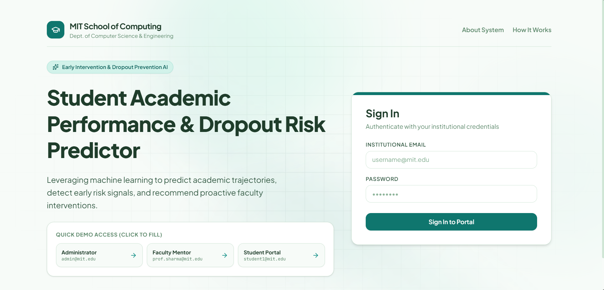
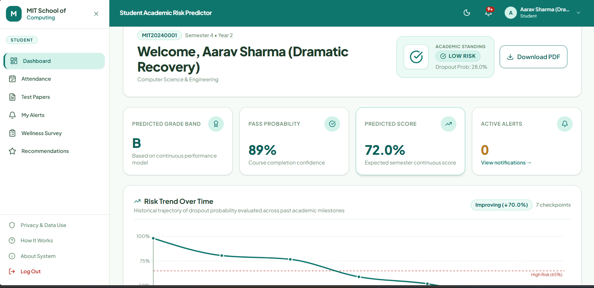
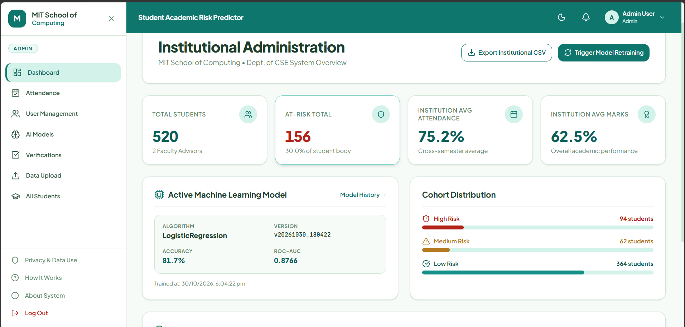
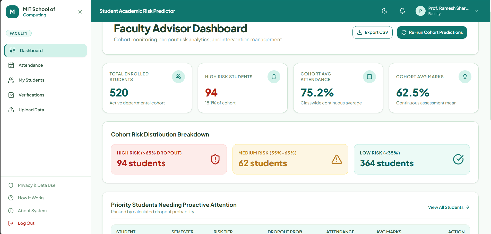
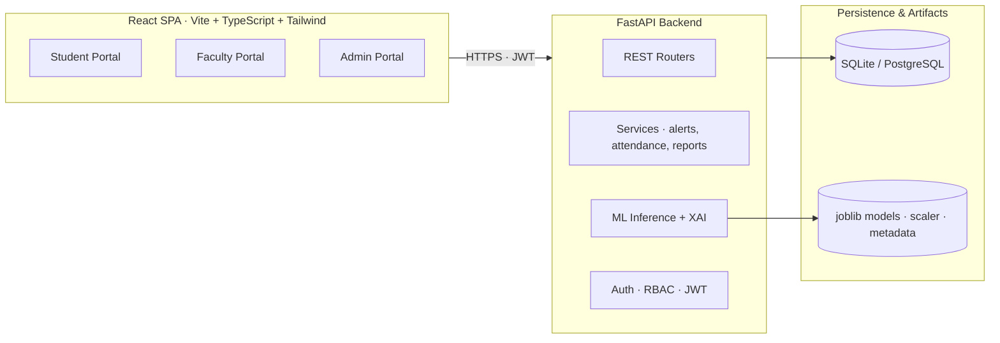

<div align="center">

# 🎓 Student Academic Performance & Dropout Risk Predictor

**An early-intervention and retention-intelligence platform for higher education.**

MIT School of Computing — Department of Computer Science & Engineering

[](#)
[](#)
[](#)
[](#)
[](#)
[](#)
[](#-testing)
[](LICENSE)

</div>

---

Traditional academic monitoring waits for end-of-semester grades — by which point a struggling student is already at risk of failing or dropping out. This platform **fuses academic records, attendance, LMS telemetry, and psychometric self-surveys** into a calibrated dropout-risk score, explains *why* a student is flagged, and gives mentors an actionable workflow to intervene early.

> **Current model:** Logistic Regression champion · **81.7% accuracy** · **ROC-AUC 0.877** · **Brier 0.129** · 5-fold CV AUC 0.869 ± 0.039

---

## ✨ Highlights

- **Early warning, not autopsies** — predicts dropout risk and grade band while there is still time to act.
- **4-algorithm tournament** with stratified 5-fold CV, isotonic probability calibration, PR curves, and Brier score.
- **Explainable by design** — per-student contributing factors, plus a **What-If simulator** that previews risk under hypothetical changes.
- **Risk-trend history** — 6–8 weekly checkpoints per student, including crafted demo trajectories (decline, recovery, steady).
- **Three role-based portals** — Student, Faculty Mentor, Institution Admin.
- **Privacy-aware** — survey consent, data-subject export/erase, and audit logging.
- **Reproducible demo** — 520 synthetic students with overlapping archetypes, plus an optional UCI dataset loader.

---

## 📸 Screenshots

| Login | Student Dashboard |
|---|---|
|  |  |

| Admin Analytics & Model Registry | Faculty Advisor Dashboard |
|---|---|
|  |  |

---

## 🚀 Features

### 🎓 Student Portal
- Personal standing: CGPA, risk tier, predicted grade band, passing probability.
- **Risk Trend** over time and **What-If Simulator** (sliders for attendance, marks, study hours, stress, motivation).
- **Wellness self-survey** with consent gate; submitting re-scores the student and can trigger alerts.
- Alerts/notifications, attendance analytics, and a **downloadable PDF report**.

### 👩‍🏫 Faculty Mentor Portal
- Cohort risk overview and searchable student directory.
- Deep-dive student profile: marks, attendance, LMS engagement, explainable factors, risk history.
- Mentoring notes, intervention messages, and counselor referrals.
- Attendance management: sessions, bulk marking, defaulters, leave requests.

### 🏛️ Institution Admin Portal
- Institutional KPIs, risk distribution, and department comparison.
- **ML model registry**: champion metrics, ROC/PR curves, calibration curve, Brier score, fairness audit, and one-click retrain.
- Batch CSV uploads, user provisioning, audit logs, and DSR export/erase.

---

## 🧠 Machine Learning

```
Raw records ──▶ Feature extraction (17 features) ──▶ Cleaning ──▶ Scaling
                                                            │
                                                            ▼
                                        4-model tournament (5-fold CV)
                          Logistic Regression · SVM · Random Forest · Gradient Boosting
                                                            │
                                                            ▼
                      Champion by ROC-AUC ──▶ Isotonic calibration ──▶ Persist
                                                            │
                                                            ▼
              Risk tier + grade band + explainable factors + recommendations
```

### The 17 features
`attendance_percentage`, `attendance_trend`, `attendance_velocity_30d`, `avg_marks`, `marks_trend`, `assignment_submission_rate`, `late_submission_rate`, `quiz_average`, `engagement_score`, `stress_score`, `motivation_score`, `study_hours`, `backlog_count`, `lms_login_frequency`, `lms_time_spent`, `lms_resource_views`, `semester`

### Evaluation (current champion)

| Metric | Value |
|---|---|
| Accuracy | **81.7%** |
| Precision | 76.2% |
| Recall | 53.3% |
| F1-score | 62.7% |
| ROC-AUC | **0.877** |
| 5-fold CV AUC | 0.869 ± 0.039 |
| Brier score | 0.129 (well-calibrated) |

- **Calibration** — `CalibratedClassifierCV` (isotonic) keeps probabilities trustworthy.
- **Explainability** — global feature importance is mapped to per-student risk/protective drivers.
- **Fairness audit** — demographic-parity and equal-opportunity gaps by gender and age group are computed at training time and surfaced in the model registry.
- **Leakage guard** — a test asserts hold-out accuracy stays below 0.99.

### Datasets
- **Synthetic (default):** 520 students with overlapping archetypes, Gaussian noise, hidden-factor label flips, and reproducible seeds.
- **UCI (optional):** `python -m data.load_uci` trains/evaluates on the public *Predict Students' Dropout and Academic Success* dataset.

---

## 🏗️ Architecture



| Layer | Technology |
|---|---|
| **API framework** | FastAPI 0.111 · Uvicorn |
| **ORM / DB** | SQLAlchemy 2.0 · SQLite (default) · PostgreSQL (optional switch) |
| **Validation** | Pydantic v2 |
| **ML** | scikit-learn 1.5 · pandas · NumPy · joblib |
| **Auth** | Bcrypt · JWT (HS256) |
| **Reporting** | ReportLab (PDF) · CSV |
| **Frontend** | React 19 · TypeScript · Vite · Tailwind CSS v4 |
| **Data viz** | Recharts |
| **State / routing** | Zustand · React Router v6 |
| **Testing** | Pytest (32 tests) |

---

## ⚡ Quick Start

### Prerequisites
Python **3.12+**, Node.js **18+**, npm. (Windows, macOS, Linux.)

### 1. Backend

```bash
cd backend
python -m venv venv
# Windows: venv\Scripts\activate    |  macOS/Linux: source venv/bin/activate
pip install -r requirements.txt
python -m data.seed        # 520 students + demo users + trained model
uvicorn app.main:app --reload --port 8000
```

- API docs: **http://localhost:8000/api/docs**

### 2. Frontend

```bash
cd frontend
npm install --legacy-peer-deps
npm run dev
```

- App: **http://localhost:5173**

### 3. One-click (Windows)

- `run_app.cmd` — sets up and launches **both** servers.
- `Start-Backend.cmd` — launches only the backend.

### 4. Docker

```bash
docker compose up --build
```

---

## 🔑 Demo Accounts

| Role | Email | Password |
|---|---|---|
| **Administrator** | `admin@mit.edu` | `Admin@123` |
| **Faculty Mentor** | `prof.sharma@mit.edu` | `Faculty@123` |
| **Faculty Mentor** | `prof.desai@mit.edu` | `Faculty@123` |

### Crafted student archetypes (great for demos)

| Email | Student | Story |
|---|---|---|
| `student1@mit.edu` | Aarav Sharma | **Dramatic recovery** (risk ~96% → ~28%) |
| `student2@mit.edu` | Diya Patel | Recovered |
| `student3@mit.edu` | Rohan Kulkarni | Steady achiever |
| `student4@mit.edu` | Ananya Iyer | Borderline |
| `student5@mit.edu` | Kabir Mehta | Disengaged |
| `student6@mit.edu` | Sneha Reddy | Backlog risk |

All student accounts use the password `Student@123`.

---

## 🗂️ Project Structure

```
predictor/
├── backend/
│   ├── app/
│   │   ├── ml/            # preprocessing, feature engineering, train, predict, fairness
│   │   ├── models/        # SQLAlchemy models
│   │   ├── routers/       # auth, students, faculty, admin, predictions, reports, attendance…
│   │   ├── schemas/       # Pydantic schemas
│   │   └── services/      # alerts, attendance, reports, student aggregation
│   ├── data/              # seed generator + UCI loader
│   └── tests/             # 32 pytest tests
├── frontend/
│   └── src/
│       ├── api/           # typed Axios client
│       ├── components/    # Layout, WhatIfSimulator, RiskTrendChart, ui/*
│       ├── pages/         # student / faculty / admin portals
│       └── store/         # Zustand auth
├── docker-compose.yml
├── run_app.cmd
└── Start-Backend.cmd
```

---

## 🔌 API Overview

| Method | Endpoint | Description |
|---|---|---|
| `POST` | `/api/auth/login` | JWT login |
| `GET` | `/api/students/me/dashboard` | Student dashboard aggregate |
| `POST` | `/api/students/me/survey` | Submit wellness survey (consent required) |
| `GET` | `/api/faculty/dashboard` | Cohort risk overview |
| `GET` | `/api/faculty/students/{id}` | Student deep-dive |
| `GET` | `/api/admin/dashboard` | Institutional KPIs |
| `GET` | `/api/admin/analytics/department-comparison` | Department comparison |
| `POST` | `/api/predictions/predict/{id}` | Score one student |
| `POST` | `/api/predictions/simulate` | **What-If simulator** (no DB writes) |
| `GET` | `/api/predictions/student/{id}/history` | Risk-trend history |
| `GET` | `/api/predictions/model-info` | Registry, calibration, PR curve, fairness |
| `POST` | `/api/predictions/train` | Retrain champion (admin) |
| `GET` | `/api/reports/student/{id}/pdf` | PDF report |
| `GET` | `/api/admin/dsr/export/{id}` | Data-subject export |
| `DELETE` | `/api/admin/dsr/delete/{id}` | Data-subject erasure |

Full interactive reference: **`/api/docs`** (Swagger).

---

## 🧪 Testing

```bash
cd backend
python -m pytest -q
```

Covers preprocessing, inference, explainability, auth/RBAC, attendance, test papers, simulation, history, and PDF export — **32 tests, all passing**.

---

## ⚠️ Limitations & Responsible Use

- **Synthetic data.** The default dataset is generated; accuracy/explanations reflect that distribution and do **not** prove real-world performance. Validate on real institutional data before any deployment.
- **Decision support only.** Predictions are estimates, not verdicts. They must never be used as sole grounds for academic decisions.
- **Fairness gaps.** The audit currently flags equal-opportunity gaps (gender ≈ 0.37, age ≈ 0.13). Addressing them is an open item.
- **"Predicted grade band"** is derived from current average marks (a heuristic), not a separately trained regressor.
- **Not production-hardened.** No migrations, rate limiting, or CI yet (roadmap below).

---

## 🗺️ Roadmap

- [ ] Alembic migrations + CI pipeline
- [ ] Rate limiting, password management, demo-mode toggle
- [ ] Mentor assignment & intervention outcome tracking
- [ ] Email/outbox notifications
- [ ] Fairness mitigation + SHAP explanations
- [ ] PostgreSQL deployment option

---

## 📄 License

Released under the **MIT License**.

<div align="center">
<sub>Built as an academic project — MIT School of Computing, Dept. of Computer Science & Engineering.</sub>
</div>
