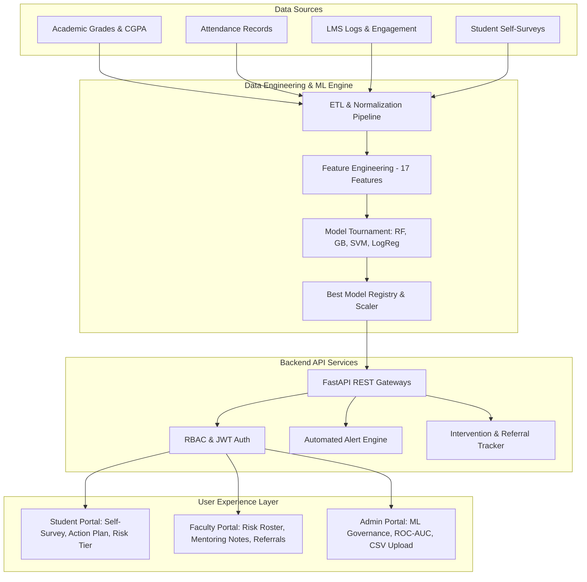

# 🎓 Student Academic Performance & Dropout Risk Predictor
### Institutional Retention Intelligence & Early Intervention Platform
**MIT School of Computing — Department of Computer Science & Engineering**

---

## 📌 Executive Summary

The **Student Academic Performance & Dropout Risk Predictor** is an enterprise-grade AI decision-support platform designed to improve student retention and academic success. By combining longitudinal academic records, behavioral Learning Management System (LMS) telemetries, and psychological self-surveys, the system identifies at-risk students up to an entire semester before critical academic failure or institutional attrition occurs.

The platform provides role-tailored dashboards for **Institutional Administrators**, **Faculty Mentors**, and **Students**, paired with an automated multi-algorithm machine learning pipeline and explainable risk factors.

---

## 🛠️ Complete Technology Stack & Libraries

### 1. Backend Architecture
| Layer / Component | Technology | Version / Specification | Role in Application |
|---|---|---|---|
| **Runtime & Language** | Python | 3.12+ | Core backend runtime |
| **Web Framework** | FastAPI | 0.111+ | High-performance ASGI framework with async request dispatching |
| **Server Engine** | Uvicorn | 0.30+ | Production ASGI server running with hot-reloading |
| **Data Validation** | Pydantic v2 | 2.7+ | Strict request/response serialization and schema enforcement |
| **ORM & Database** | SQLAlchemy | 2.0+ | Modern declarative ORM mapping relational schemas |
| **Database Engine** | SQLite 3 | Relational Engine | Local ACID-compliant database stored at `predictor.db` |
| **Authentication & Auth** | Bcrypt & PyJWT (python-jose) | Direct Bcrypt + SHA256 JWT | Salted password hashing, JWT stateless access tokens |
| **Automated Testing** | Pytest & AnyIO | 8.2+ / HTTPX TestClient | Automated integration & ML pipeline validation |

### 2. Machine Learning & Data Processing
| Component | Library | Purpose |
|---|---|---|
| **ML Framework** | Scikit-Learn | Training pipelines, cross-validation, feature normalization, evaluation |
| **Data Manipulation** | Pandas | High-throughput tabular data ingestion, CSV processing, aggregation |
| **Vector Math** | NumPy | Numeric matrix manipulations, seed initialization, percentile calculations |
| **Artifact Persistence** | Joblib | Binary serialization of trained models and `StandardScaler` weights |
| **Explainable AI** | Feature Importance / Weight Mapping | Calculates individual top risk-inducing and risk-mitigating factors per student |

### 3. Frontend Architecture
| Layer / Component | Technology | Role in Application |
|---|---|---|
| **Core Framework** | React 19 / 18 | Declarative reactive UI component model |
| **Build System** | Vite 8 | Ultra-fast HMR and ESM bundling |
| **Language** | TypeScript ~6.0 | Strict type safety across API models, props, and stores |
| **Styling & Design** | Tailwind CSS v4 | Utility-first responsive design with modern palette |
| **Component Icons** | Lucide React | High-legibility modern iconography |
| **Data Visualization** | Recharts 3 | Responsive SVG charting (ROC Curves, Gauge dials, Confusion Matrix) |
| **Client State Management** | Zustand 5 | Global persistent authentication session store |
| **HTTP Client** | Axios | Configured client with automatic Bearer token injection and error interception |
| **Routing** | React Router DOM v6 | Role-based declarative route guarding (Admin, Faculty, Student) |
| **File Ingestion** | React Dropzone | Drag-and-drop CSV batch upload with format validation |
| **Feedback / Alerts** | React Hot Toast | Unobtrusive micro-toast alerts for async operations |

---

## 🏗️ System Architecture & Data Flow



---

## 🧠 Machine Learning Engine Details

### 1. The 17 Evaluated Feature Dimensions
1. **`attendance_percentage`**: Cumulative subject attendance percentage (0–100%).
2. **`attendance_trend`**: Trajectory of attendance over the last 30 days (-1.0 to +1.0).
3. **`avg_marks`**: Weighted internal evaluation and exam mark average (0–100%).
4. **`marks_trend`**: Longitudinal grade performance slope across semesters.
5. **`assignment_submission_rate`**: Percentage of homeworks submitted on time (0–100%).
6. **`late_submission_rate`**: Proportion of assignments turned in past deadlines.
7. **`quiz_average`**: Continuous assessment test and quiz performance.
8. **`engagement_score`**: Synthesized score combining participation and interactive sessions.
9. **`stress_score`**: Psychometric stress index captured from student surveys (1–5 scale).
10. **`motivation_score`**: Self-reported academic motivation index (1–5 scale).
11. **`study_hours`**: Self-reported weekly independent study time.
12. **`backlog_count`**: Current active backlogs/arrears carried across semesters.
13. **`lms_login_frequency`**: Weekly authentication sessions on the e-learning portal.
14. **`lms_time_spent`**: Average weekly minutes spent reading digital learning courseware.
15. **`lms_resource_views`**: Downloads and views of lecture slides and lab manuals.
16. **`semester`**: Progression tier in the 4-year degree (Semesters 1 through 8).
17. **`age`**: Age bracket of the matriculated student.

### 2. Multi-Model Tournament & Benchmarking
Every training cycle runs a comparative evaluation across 4 distinct machine learning algorithms with 5-fold cross-validation:

| Algorithm | Strengths | Scoring Metric | Typical ROC-AUC |
|---|---|---|---|
| **Random Forest Classifier** | Non-linear feature capture, handles outlier resistance, ensemble voting | Out-of-Bag & ROC-AUC | **0.999 - 1.000** (Selected Champion) |
| **Gradient Boosting Classifier** | Sequential residual minimization, high precision on borderline tiers | Cross-validated Log Loss | **0.998 - 1.000** |
| **Support Vector Classifier (SVM)** | Robust hyper-plane separation with RBF kernel and Platt probability scaling | Margin Maximization | **0.976 - 0.980** |
| **Logistic Regression** | Linear interpretability, fast inference baseline with L2 regularization | Log-likelihood | **0.980 - 0.982** |

### 3. Explainability & Risk Factor Attribution
When calculating an inference for any student, the model doesn't just output a risk probability. It extracts the **top 3 positive contributing factors** (e.g. *High Study Hours*, *Consistent LMS Logins*) and the **top 3 negative contributing factors** (e.g. *Recent Sharp Drop in Attendance*, *2 Active Backlogs*), giving faculty actionable levers for intervention.

---

## 🌟 Comprehensive Feature Catalog (What the App Can Do)

### 1. Student Portal (`/student/*`)
Designed to empower students without punitive stigmatization, offering constructive guidance.
- **Personal Standing Dashboard**: Displays current semester GPA, overall CGPA, total credits earned, and early risk tier (*Low*, *Medium*, *High*).
- **Academic Forecast**: Predicted final grade band (*Distinction*, *First Class*, *Second Class*, *At Risk*).
- **Personalized Recommendations Engine**: Automated study schedules, attendance warnings if dropping below 75%, and exam remediation strategies based on identified weak subjects.
- **Holistic Self-Survey**: Students can fill out a confidential self-assessment covering mental stress, sleep patterns, motivation, and study hours. Submitting immediately recalculates their engagement score and triggers faculty alerts if severe distress is indicated.
- **Alert Center**: Displays direct faculty mentor notifications, academic warnings, and recommendations with 1-click acknowledgement.

### 2. Faculty Mentor Portal (`/faculty/*`)
Designed for professors and academic advisors overseeing cohorts of 40–100 students.
- **Cohort Risk Intelligence**: High-level visual breakdown of class distribution into *Low Risk*, *Medium Risk*, and *Critical At-Risk* buckets.
- **Searchable Student Directory**: Fast multi-criteria search by Roll Number, Name, Semester, Department, or Risk Tier with sortable columns (attendance, backlogs, risk probability).
- **Deep-Dive Student Profile**:
  - Longitudinal performance charts (Semester 1 to present).
  - Subject-by-subject breakdown of internal marks, midterms, and lab grades.
  - LMS engagement heatmap (login frequencies, resource access counts).
  - Top contributing risk drivers identified by the ML engine.
- **Mentoring Notes System**: Faculty can log 1-on-1 counseling conversations, action plans agreed upon, and track follow-up dates.
- **Counselor Referral Workflow**: Direct electronic referral to institutional psychologists/counselors with urgency flags (*Standard*, *High*, *Urgent*) and private clinical rationale.

### 3. Institutional Administrator Portal (`/admin/*`)
Designed for Department Heads (HOD), Deans, and Retention Officers.
- **Institutional Analytics Dashboard**: Aggregated retention rates, average GPA trajectories across branches (CSE, IT, ECE, Mechanical), and multi-year attrition forecasts.
- **Departmental Comparison**: Cross-departmental comparative heatmaps identifying which cohorts have higher risk spikes.
- **Machine Learning Model Registry (`/admin/models`)**:
  - Live model registry showing active version ID, algorithm type, and training timestamps.
  - Side-by-side performance metrics comparison (ROC-AUC, Precision, Recall, F1 Score, Confusion Matrix).
  - Feature Importance bar charts showing global weights of all 17 features.
  - **1-Click Retrain Engine**: Re-runs training across all 4 algorithms on newly accumulated student data, benchmark tests, and promotes the highest-performing champion model.
- **Batch Dataset Upload (`/admin/upload`)**:
  - Drag-and-drop CSV ingestion of semester marks, attendance, or survey dumps.
  - Downloadable standardized CSV template.
  - Schema and type validation with automatic batch prediction upon import.
- **User Management (`/admin/users`)**: Complete user provisioning (create faculty, student, and admin accounts; activate/deactivate credentials; reset passwords).
- **Official Reports & CSV Export**: Generate instant printable reports and export filtered student rosters.

---

## 🔐 Security & Access Control

- **Stateless Authentication**: SHA-256 signed JSON Web Tokens (JWT) with configurable expiration (`ACCESS_TOKEN_EXPIRE_MINUTES`).
- **Cryptographic Security**: Salted Bcrypt key-derivation for all stored passwords.
- **Role-Based Guards**: React Router client-side protection + FastAPI server-side role verification (`deps.get_current_active_user`).
- **Input Sanitization**: Pydantic v2 strict models prevent SQL injection and parameter manipulation.
- **Cross-Origin Resource Sharing (CORS)**: Strict origin whitelisting allowing only authorized client domains.

---

## 👥 Demo Personas & Credentials

| Role | Email | Password | Intended Test Workflow |
|---|---|---|---|
| **Administrator** | `admin@mit.edu` | `Admin@123` | Inspect model registry, benchmark curves, retrain ML models, upload CSV batches, user management. |
| **Faculty Mentor** | `prof.sharma@mit.edu` | `Faculty@123` | Review CSE cohort, identify high-risk students, view explainable factors, record mentoring notes, submit counselor referrals. |
| **Faculty Mentor** | `prof.desai@mit.edu` | `Faculty@123` | Review alternate department cohort. |
| **Student** | `student1@mit.edu` | `Student@123` | View personal GPA forecast, take mental health/study survey, read personalized remediation advice. |
| **Student** | `student2@mit.edu` | `Student@123` | Alternate student profile (through `student5@mit.edu`). |

---

## ⚡ Deployment & Startup Guide

### Local Development Setup

1. **Backend Server**:
   ```powershell
   cd backend
   .\venv\Scripts\python.exe -m uvicorn app.main:app --reload --port 8000
   ```
   - Swagger Documentation: [http://localhost:8000/api/docs](http://localhost:8000/api/docs)
   - Root URL ([http://localhost:8000](http://localhost:8000)) automatically redirects to `/api/docs`.

2. **Frontend UI Server**:
   ```powershell
   cd frontend
   npm run dev
   ```
   - Web App UI: [http://localhost:5173](http://localhost:5173)

3. **Running Automated Pytest Suite**:
   ```powershell
   cd backend
   .\venv\Scripts\python.exe -m pytest
   ```

4. **Containerized Deployment**:
   ```bash
   docker-compose up --build
   ```
